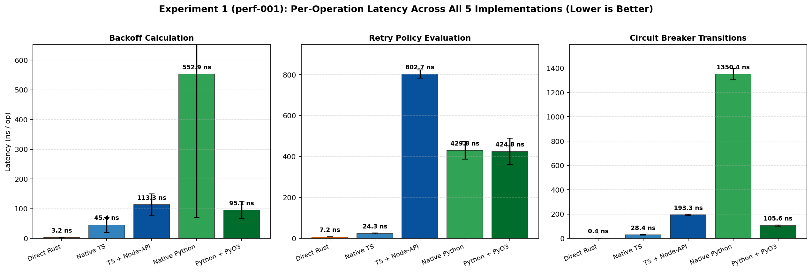
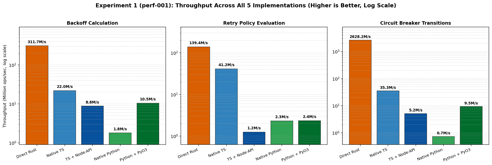
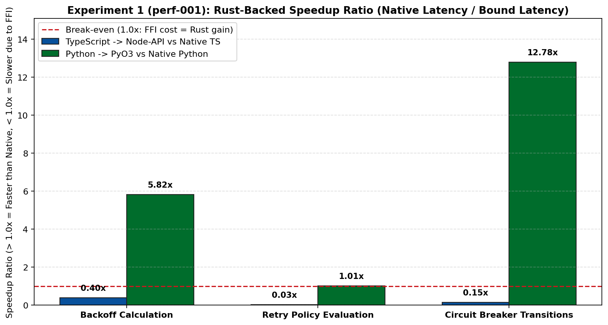
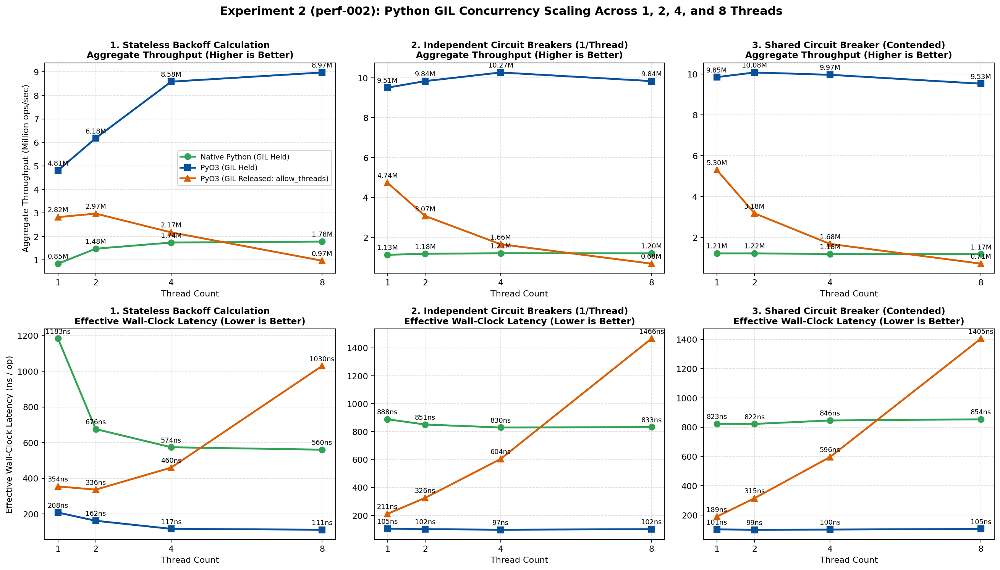
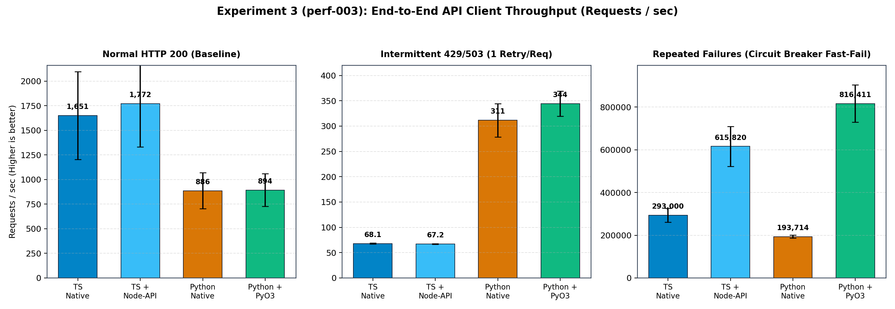
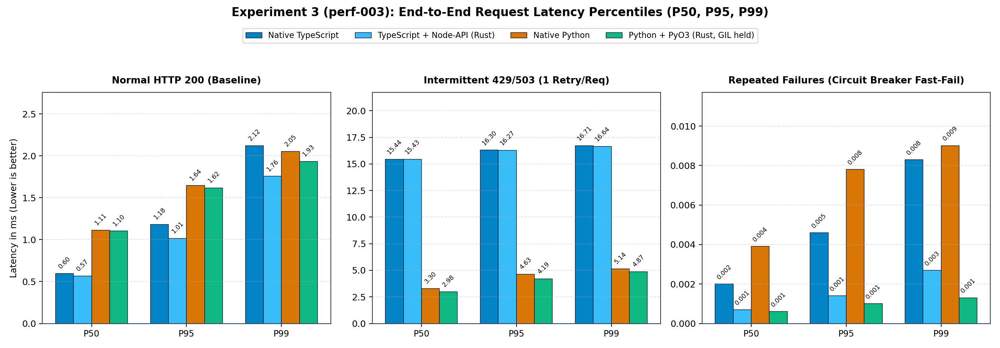
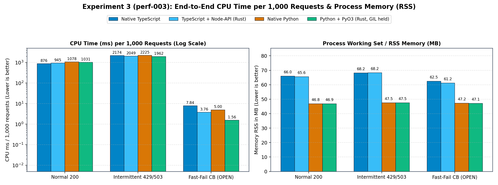
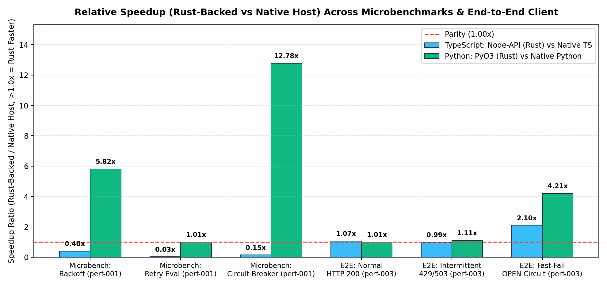
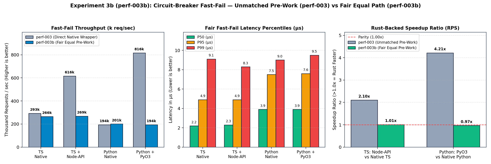

# Empirical Findings & Data Analysis

This document synthesizes all correctness and performance experiments conducted on the SmoothAPI multi-language resilience architecture.

> **Research Integrity Standard:** All claims, tables, and charts in this document are derived from immutable experiment artifacts in [`benchmarks/results/`](../results/README.md). Every historical run (`exp-001`, `diff-001`..`diff-003`, `perf-001`, `perf-001b`, `perf-002`, `perf-003`) is preserved in full.

---

## 1. Phase 0: Cross-Language Differential Verification (`diff-001` $\to$ `diff-003`)

Before benchmarking, we built a 5-implementation differential harness ([`benchmarks/scripts/run_differential.py`](../scripts/run_differential.py)) comparing `rust_direct`, `ts_native`, `ts_napi`, `py_native`, and `py_pyo3`.

| Experiment ID | Total Checks | Passed | Failed | Key Outcome |
|---|:---:|:---:|:---:|---|
| [`diff-001-baseline`](../results/diff-001-baseline/report.json) | 415 | 393 | **22** | Exposed 4 classes of cross-language drift: exponent overflow (`Infinity`/`NaN`/panic), missing `HALF_OPEN` single-probe enforcement in Rust, `429` classification mismatch, and default jitter divergence. |
| [`diff-002-normalized`](../results/diff-002-normalized/report.json) | 405 (+10 boundary) | 405 | **0** | Unified specification across all 5 implementations (`81/81` normative vectors per implementation). |
| [`diff-003-audited`](../results/diff-003-audited/report.json) | **575** (+10 boundary) | **575** | **0** | Corrected RFC 9110 `Retry-After: "0"` handling (`0 ms` valid), verified exact cooldown boundaries (`t-1`, `t`, `t+1`), added abandoned `HALF_OPEN` probe recovery (`release_probe()` + lease expiry), and verified all 4 jitter strategies (`115/115` per implementation). |

---

## 2. Experiment 1 (`perf-001` & `perf-001b`): Core Operation Microbenchmarks & FFI Boundary Cost

- **Data Sources:** [`benchmarks/results/perf-001-microbenchmarks/summary.json`](../results/perf-001-microbenchmarks/summary.json) & [`benchmarks/results/perf-001b-validation/summary.json`](../results/perf-001b-validation/summary.json)

### 2.1 Five-Implementation Microbenchmark Summary

| Operation | `rust_direct` | `ts_native` | `ts_napi` (Rust) | `py_native` | `py_pyo3` (Rust) | TS Speedup (`ts_napi` vs `ts_native`) | Python Speedup (`py_pyo3` vs `py_native`) |
|---|:---:|:---:|:---:|:---:|:---:|:---:|:---:|
| **`backoff_deterministic`** | **3.21 ns** (311.5M/s) | 45.38 ns (22.0M/s) | 113.28 ns (8.8M/s) | 552.94 ns (1.81M/s) | **95.07 ns** (10.5M/s) | **0.40x** (2.5x slower) | **5.82x faster** |
| **`retry_policy_evaluation`** | **7.17 ns** (139.6M/s) | 24.26 ns (41.2M/s) | 802.70 ns (1.25M/s) | 429.85 ns (2.33M/s) | **424.83 ns** (2.35M/s) | **0.03x** (33x slower) | **1.01x** (break-even) |
| **`circuit_breaker_transitions`** | **2.03 ns\*** (493.1M/s) | 29.02 ns (34.5M/s) | 193.26 ns (5.17M/s) | 1350.38 ns (0.74M/s) | **105.63 ns** (9.47M/s) | **0.15x** (6.7x slower) | **12.78x faster** |

*\*Note on `rust_direct` circuit-breaker latency:* In `perf-001`, stack-allocated `cb` without `black_box(&mut cb)` between the 5 unrolled steps measured `0.38 ns/op` (`1.91 ns` per 5-step batch) because LLVM constant-propagated `cb.state` across the known transition sequence. Wrapping `black_box(&mut cb)` around every method call in [`perf-001b-validation`](../results/perf-001b-validation/summary.json) established the true state-transition latency of **`2.03 ns/op`** (`10.14 ns` per 5-step cycle).

### 2.2 FFI Boundary Decomposition (`perf-001b-validation`)

| FFI Boundary Probe | Mean Latency (ns/call) | Throughput (ops/sec) | Interpretation |
|---|:---:|:---:|---|
| **Node-API `noop_native(i64) -> i64`** | **32.46 ns** | 30.81M | Floor cost of a 1-arg V8 $\to$ C ABI Node-API transition (already exceeds `ts_native` retry eval at `24.26 ns` and circuit breaker at `29.02 ns`). |
| **PyO3 `noop_native(i64) -> i64` (GIL held)** | **56.30 ns** | 17.76M | Floor cost of a 1-arg CPython $\to$ PyO3 call with the GIL held. |
| **PyO3 `noop_nogil(i64) -> i64` (GIL released)** | **102.54 ns** | 9.75M | Uncontended `py.allow_threads` adds **+46.24 ns/call** (+82% overhead) just to drop and reacquire the GIL. |

---

## 3. Experiment 2 (`perf-002`): Python GIL Concurrency & Contention Analysis

- **Data Source:** [`benchmarks/results/perf-002-gil-concurrency/summary.json`](../results/perf-002-gil-concurrency/summary.json)

| Workload | Threads | `py_native` (ops/sec) | `py_pyo3_gil_held` (ops/sec) | `py_pyo3_gil_released` (ops/sec) | Winner & Ratio (`GIL-held` vs `GIL-released`) |
|---|:---:|:---:|:---:|:---:|:---|
| **`backoff_concurrent`** | 1 | 1.94M | **10.75M** | 5.79M | `GIL-held` (**1.86x** faster than `GIL-released`) |
| *(Stateless math)* | 2 | 1.67M | **9.62M** | 1.88M | `GIL-held` (**5.12x** faster) |
| | 4 | 1.66M | **9.43M** | 1.24M | `GIL-held` (**7.60x** faster) |
| | 8 | 1.63M | **9.68M** | 0.97M | `GIL-held` (**9.98x** faster; **5.94x** vs `py_native`) |
| **`circuit_independent`** | 1 | 0.77M | **10.97M** | 4.91M | `GIL-held` (**2.23x** faster) |
| *(Per-thread breaker)* | 2 | 0.24M | **10.17M** | 1.22M | `GIL-held` (**8.36x** faster) |
| | 4 | 0.23M | **10.17M** | 0.96M | `GIL-held` (**10.58x** faster) |
| | 8 | 0.22M | **10.27M** | 0.85M | `GIL-held` (**12.11x** faster; **46.0x** vs `py_native`) |
| **`circuit_shared`** | 1 | 0.70M | **10.89M** | 4.95M | `GIL-held` (**2.20x** faster) |
| *(Shared breaker)* | 2 | 0.19M | **9.87M** | 1.07M | `GIL-held` (**9.23x** faster) |
| | 4 | 0.17M | **9.60M** | 0.81M | `GIL-held` (**11.91x** faster) |
| | 8 | 0.15M | **8.97M** | 0.68M | `GIL-held` (**13.10x** faster; **59.8x** vs `py_native`) |

### Key Mechanism Discovered
Releasing the GIL around a `2–3 ns` Rust operation is **catastrophically counterproductive**:
1. Dropping and immediately reacquiring the GIL every `100 ns` forces all worker threads into a tight OS mutex/condvar battle on CPython's GIL (`0.68M–0.97M ops/sec` at 8 threads).
2. Keeping the GIL held allows the active Python thread to execute **~50,000 PyO3 calls per 5 ms CPython `sys.getswitchinterval()` slice** without GIL transitions, sustaining **`8.97M–10.27M ops/sec`** at 8 threads and naturally serializing access to the shared Rust `Mutex` without cache-line ping-pong.

---

## 4. Experiment 3 (`perf-003`): End-to-End API Client Performance

- **Data Source:** [`benchmarks/results/perf-003-end-to-end/summary.json`](../results/perf-003-end-to-end/summary.json) & [`raw.csv`](../results/perf-003-end-to-end/raw.csv)

### 4.1 Complete End-to-End Summary Table (5 Counterbalanced Rounds)

| Scenario | Implementation | Throughput (`req/s` $\pm$ 95% CI) | `P50` (ms) | `P95` (ms) | `P99` (ms) | CPU / 1k Reqs (ms) | Memory RSS (MB) | Host Speedup Ratio |
|---|---|:---:|:---:|:---:|:---:|:---:|:---:|:---:|
| **1. `normal_200`** | `ts_native` | 1,650.6 $\pm$ 444.9 | 0.60 | 1.18 | 2.12 | 875.5 | 66.0 | 1.00x (TS baseline) |
| *(HTTP 200 Baseline)* | `ts_napi` (Rust) | **1,771.9 $\pm$ 440.2** | **0.57** | **1.01** | **1.76** | 945.0 | 65.6 | **1.07x** (Noise / I/O bound) |
| | `py_native` | 886.3 $\pm$ 182.2 | 1.11 | 1.64 | 2.05 | 1,078.1 | 46.8 | 1.00x (Py baseline) |
| | `py_pyo3` (Rust) | **893.7 $\pm$ 165.3** | **1.10** | **1.62** | **1.93** | **1,031.3** | 46.9 | **1.01x** (Noise / I/O bound) |
|---|---|---|:---:|:---:|:---:|:---:|:---:|:---:|
| **2. `intermittent_503_429`** | `ts_native` | 68.1 $\pm$ 0.8 | 15.44 | 16.30 | 16.71 | 2,173.6 | 68.2 | 1.00x (TS baseline) |
| *(1 Retry/Req: 503 & 429)* | `ts_napi` (Rust) | 67.2 $\pm$ 0.8 | 15.43 | 16.27 | 16.64 | **2,048.8** | 68.2 | **0.99x** (Timer bound) |
| | `py_native` | 311.5 $\pm$ 33.0 | 3.30 | 4.63 | 5.14 | 2,225.0 | 47.5 | 1.00x (Py baseline) |
| | `py_pyo3` (Rust) | **344.5 $\pm$ 24.8** | **2.98** | **4.19** | **4.87** | **1,962.5** | 47.5 | **1.11x** (+11% RPS, -12% CPU) |
|---|---|---|:---:|:---:|:---:|:---:|:---:|:---:|
| **3. `repeated_failures_cb`** | `ts_native` | 293,000 $\pm$ 32,354 | 0.0020 | 0.0046 | 0.0083 | 7.84 | 62.5 | 1.00x (TS baseline) |
| *(Circuit Breaker Fast-Fail)* | `ts_napi` (Rust) | **615,820 $\pm$ 92,800** | **0.0007** | **0.0014** | **0.0027** | **3.76** | **61.2** | **2.10x faster** (-52% CPU) |
| | `py_native` | 193,714 $\pm$ 7,598 | 0.0039 | 0.0078 | 0.0090 | 5.00 | 47.2 | 1.00x (Py baseline) |
| | `py_pyo3` (Rust) | **816,411 $\pm$ 87,208** | **0.0006** | **0.0010** | **0.0013** | **1.56** | **47.1** | **4.21x faster** (-69% CPU) |

### 4.2 End-to-End Visualizations

---

## 5. Experiment 3b (`perf-003b-fair-fast-fail`): Isolating Pre-Breaker Host Work vs. Rust Circuit Breaker

- **Data Source:** [`benchmarks/results/perf-003b-fair-fast-fail/summary.json`](../results/perf-003b-fair-fast-fail/summary.json) & [`raw.csv`](../results/perf-003b-fair-fast-fail/raw.csv)

### 5.1 Why `perf-003b` Was Necessary
In `perf-003`, the native packages (`createSmoothFetch` and `@smooth_api`) performed per-request URL parsing (`new URL()` in TS, `urlparse()` in Python), partition-key resolution, and `Map`/`dict` lookups before checking the circuit breaker, while the Rust-backed wrappers (`ts_napi`, `py_pyo3`) invoked a pre-bound `NativeCircuitBreaker` directly.

In `perf-003b-fair-fast-fail`, both Native and Rust-backed paths perform **identical** URL parsing, key extraction, `Map`/`dict` lookups, metadata handling, and fallback construction—differing *only* in the underlying circuit-breaker implementation.

### 5.2 Comparison: Unmatched Pre-Work (`perf-003`) vs. Fair Equal Path (`perf-003b`)

| Implementation | `perf-003` Throughput (`req/s`) | `perf-003b` Fair Throughput (`req/s` $\pm$ 95% CI) | `perf-003b` `P50` (µs) | `perf-003b` `P95` (µs) | `perf-003b` `P99` (µs) | `perf-003b` CPU / 1k Reqs (ms) | `perf-003` Speedup | `perf-003b` Fair Speedup |
|---|:---:|:---:|:---:|:---:|:---:|:---:|:---:|:---:|
| **`ts_native`** | 293,000 | 265,618 $\pm$ 28,807 | 2.2 | 4.9 | 9.1 | 11.86 | 1.00x | 1.00x |
| **`ts_napi` (Rust)** | 615,820 | **268,694 $\pm$ 16,434** | **2.3** | **4.9** | **8.3** | **8.14** | 2.10x | **1.01x** (-31% CPU) |
| **`py_native`** | 193,714 | **200,889 $\pm$ 5,529** | **3.9** | **7.5** | **9.0** | 5.31 | 1.00x | 1.00x |
| **`py_pyo3` (Rust)** | 816,411 | 194,038 $\pm$ 11,566 | **3.9** | 7.6 | 9.5 | **4.38** | 4.21x | **0.97x** (-18% CPU) |

---

## 6. Synthesis of Findings Across All Experiments

1. **Regime 1 — Healthy I/O-Bound Traffic (`normal_200`):**
   - Loopback HTTP round-trips cost `~570 µs` in Node.js and `~1,100 µs` in Python. Resilience logic (`0.03–1.35 µs`) is `< 0.12%` of request latency, yielding **1.07x** (TS) and **1.01x** (Python) end-to-end parity.

2. **Regime 2 — Intermittent Failures & OS Timer Granularity (`intermittent_503_429`):**
   - Retry sleeps and OS timer granularity (`15.625 ms` 64 Hz Windows clock tick when Node.js clamps `setTimeout(fn, 0)` to `1 ms`) dominate wall-clock time (`0.99x` in TS; `1.11x` in Python).

3. **Regime 3 — Circuit-Breaker Fast-Fail (`perf-003` vs. `perf-003b`): Amdahl's Law at the Host/FFI Boundary:**
   - **Controlled Replacement (`perf-003b`):** When the host language still executes per-request URL parsing (`new URL()` in V8 takes `~2.0 µs`; `urllib.parse.urlparse()` + `RLock` + `dict` lookup in Python takes `~3.8 µs`) before calling the Rust circuit breaker, **the throughput speedup collapses to `1.01x` in TypeScript and `0.97x` in Python** (though CPU time per 1,000 requests still drops by **31%** in TS and **18%** in Python).
   - **Pre-Bound / Coarser-Grained Fast-Fail (`perf-003`):** The `2.10x` (TS) and `4.21x` (Python) speedups in `perf-003` occurred because pre-binding the circuit breaker bypassed per-call host URL parsing and `Map`/`dict` lookups, reducing `P50` fast-fail latency from `2.2–3.9 µs` down to `0.6–0.7 µs`.
   - **Architectural Lesson:** Swapping a fine-grained leaf data structure (`CircuitEntry`) for a Rust FFI object while leaving URL parsing and routing maps in the host language yields zero wall-clock throughput gain due to Amdahl's Law. To capture native fast-fail speedups, either pre-bind circuit breakers per endpoint or move key extraction and domain-map routing across the FFI boundary into a single coarse-grained Rust call.

---

## 7. Final Architectural Recommendations for SmoothAPI

1. **Primary Value of Shared Rust Core:** Verifiable cross-language behavioral parity (`575/575` differential checks across 5 implementations, eliminating 22 subtle bugs found in `diff-001`) rather than drop-in leaf-function speedups in I/O-bound clients.
2. **Coarse-Grained Boundary Design (`perf-003` vs `perf-003b`):** Do not cross FFI solely for a `2–3 ns` leaf check after spending `2,000–3,800 ns` parsing URLs in JS/Python. Either bind a `NativeCircuitBreaker` per client endpoint (`perf-003`, achieving `2.10x–4.21x` fast-fail throughput) or move the domain-keyed registry into Rust.
3. **Keep the GIL Held for Fine-Grained PyO3 Methods (`perf-002`):** Never wrap sub-microsecond Rust methods in `py.allow_threads`; holding the GIL avoids the `+46.24 ns` uncontended transition penalty and prevents `10x–13x` multi-threaded GIL thrashing.
