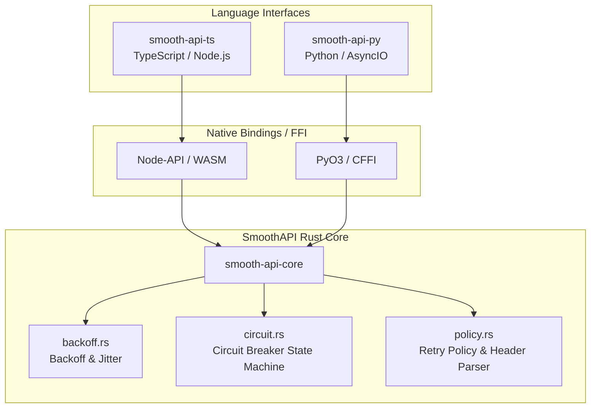

<p align="center">
  <a href="https://smoothapi.org"></a>
</p>

<p align="center">
  A high-performance, zero-dependency Rust resilience engine powering SmoothAPI's cross-language architecture.
</p>

<p align="center">
  <b>Deterministic Calculations · Exponential Backoff · Jitter · Circuit Breakers · Retry Policy Engine</b>
</p>

<p align="center">
  <a href="https://github.com/AryanSharma48/smoothAPI/actions"></a>
  <a href="https://crates.io"></a>
  <a href="../LICENSE"></a>
  <a href="https://doc.rust-lang.org"></a>
</p>

---

## Why SmoothAPI Core?

**SmoothAPI Core** (`smooth-api-core`) is the shared, deterministic resilience engine designed to power SmoothAPI across multiple programming languages. 

Rather than duplicating critical arithmetic, timing logic, and state machines across TypeScript, Python, and future runtimes, `smooth-api-core` provides:

- **Mathematical parity:** Guarantees that backoff intervals, jitter distributions, and circuit state transitions behave identically regardless of caller language.
- **Arithmetic safety:** Protection against integer overflow panics and silent wraparounds at high attempt counts using saturating arithmetic.
- **Zero dependencies:** Written purely with the Rust standard library (`std`). No runtime dependencies, async runtimes, or heavy third-party crates.
- **Clean separation of concerns:** Keeps resilience decisions and state management independent of language-specific HTTP clients, promises, or async engines.

---

## Architecture

The Rust core executes the deterministic decision logic and state transitions, while networking and I/O remain native to each language wrapper:



---

## Modules & Capabilities

### 1. Exponential Backoff & Jitter (`backoff.rs`)
Calculates safe, bounded retry delays with four distinct jitter strategies to mitigate thundering herds:

- **`None`:** Deterministic exponential delay: $\min(\text{max\_delay}, \text{base} \times 2^{\text{attempt}})$.
- **`Full`:** Uniform random spread between $0$ and the capped delay.
- **`Equal`:** Preserves $50\%$ of the exponential delay and jitters the remaining half.
- **`Decorrelated`:** Dynamically scales between $\text{base}$ and $3 \times \text{previous\_delay}$.

```rust
use smooth_api_core::{calculate_backoff, BackoffConfig, JitterStrategy};

let config = BackoffConfig {
    base_delay_ms: 100,
    max_delay_ms: 10_000,
    max_retries: 3,
    jitter: JitterStrategy::Equal,
};

// Returns a safe, jittered delay in milliseconds
let delay = calculate_backoff(1, &config, None, 0.5);
```

### 2. Circuit Breaker (`circuit.rs`)
Tracks health and failure rates to fail fast and prevent cascading downstream outages:

- **`CircuitBreaker`:** Finite-state machine (`Closed` $\to$ `Open` $\to$ `HalfOpen`).
- **`CircuitBreakerState`:** Per-domain registry (`HashMap<String, CircuitBreaker>`) ensuring failures on one API host do not disrupt healthy endpoints.

```rust
use smooth_api_core::{CircuitBreakerConfig, CircuitBreakerState, CircuitState};

let mut state = CircuitBreakerState::default();

// Check if request is permitted
if state.can_request("api.stripe.com", 1000) {
    // Record failures if downstream returns errors
    state.record_failure("api.stripe.com", 1000);
}
```

### 3. Policy & Decision Engine (`policy.rs`)
Centralizes HTTP status code evaluation and server rate-limit headers:

- Evaluates status codes against configurable retry lists (`[429, 500, 502, 503, 504]`).
- Parses and enforces `Retry-After` seconds headers for `429 Too Many Requests`.
- Returns clean, explicit decisions: `Retry { delay_ms }`, `Success`, `Exhausted`, or `Terminal`.

```rust
use smooth_api_core::{evaluate_response, BackoffConfig, RetryDecision};

let config = BackoffConfig::default();

let decision = evaluate_response(
    429,            // HTTP status
    0,              // attempt
    &config,
    Some("5"),      // Retry-After header
    None,           // prev_delay_ms
    0.0,            // random_factor
);

assert_eq!(decision, RetryDecision::Retry { delay_ms: 5000 });
```

---

## Workspace Layout

```text
core/
├── README.md               # Core engine architecture & documentation
└── rust/                   # Rust crate root (smooth-api-core)
    ├── Cargo.toml          # Package manifest
    ├── Cargo.lock          # Dependency lockfile
    └── src/
        ├── lib.rs          # Module declarations and public API re-exports
        ├── backoff.rs      # Exponential backoff calculations & jitter algorithms
        ├── circuit.rs      # Circuit breaker state machine & per-domain registry
        └── policy.rs       # HTTP retry eligibility & Retry-After evaluation
```

---

## Development & Testing

### Prerequisites
- [Rust & Cargo](https://rustup.rs/) (2024 edition or newer)

### Build the Library
```bash
cd core/rust
cargo build
```

### Run Tests
The test suite validates state transitions, jitter distributions, arithmetic boundary conditions, and overflow handling:

```bash
cd core/rust
cargo test
```

### Run Optimized Release Build
```bash
cd core/rust
cargo build --release
```

---

## Benchmarking Roadmap

To evaluate the benefits and trade-offs of a shared Rust core, SmoothAPI follows an incremental 5-milestone benchmarking methodology:

1. **Milestone 1 — Backoff:** Exponential backoff calculations, delay limits, and overflow safety. *(Completed)*
2. **Milestone 2 — Jitter:** Deterministic and randomized jitter strategy evaluation. *(Completed)*
3. **Milestone 3 — Retry Policy:** Attempt limits, status-code filtering, and `Retry-After` parsing. *(Completed)*
4. **Milestone 4 — Native Baselines:** Ensure equivalent TypeScript and Python implementations pass identical correctness tests. *(Completed)*
5. **Milestone 5 — Microbenchmarks:** Measure computation cost, throughput (ops/sec), and native binding FFI overhead under equivalent workloads. *(Baseline Completed)*

### Baseline Findings (`exp-001`)


Full statistical logs, raw CSVs, and measurement controls are available in the [research/](../research) directory and [benchmarks/](../benchmarks).

> **Research Note:** Comparing raw Rust computation against interpreted or JIT-compiled runtimes measures execution cost alone. Production viability requires accounting for language binding overhead (Node-API / PyO3) and realistic network latency.

---

## Contributing

Contributions to the Rust core are welcome! Please ensure:
1. All changes include focused unit tests in their respective `tests` module.
2. Code follows clean, concise, idiomatic Rust standards without unnecessary external dependencies.
3. All tests pass with `cargo test` prior to opening a pull request.

Review our root [Contributing Guidelines](../CONTRIBUTING.md) for more details.

---

## License

[MIT](../LICENSE)
