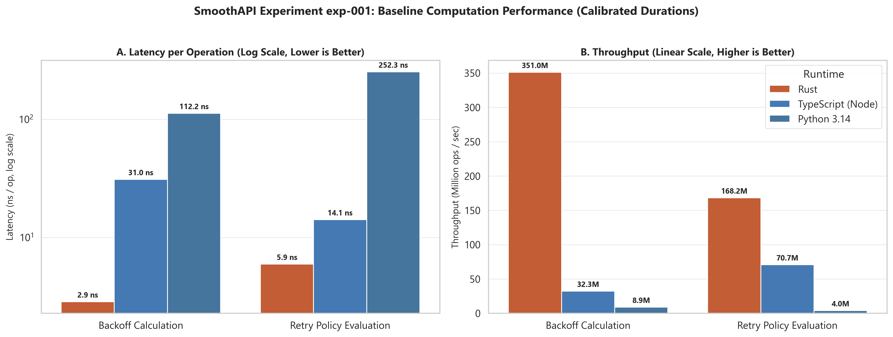
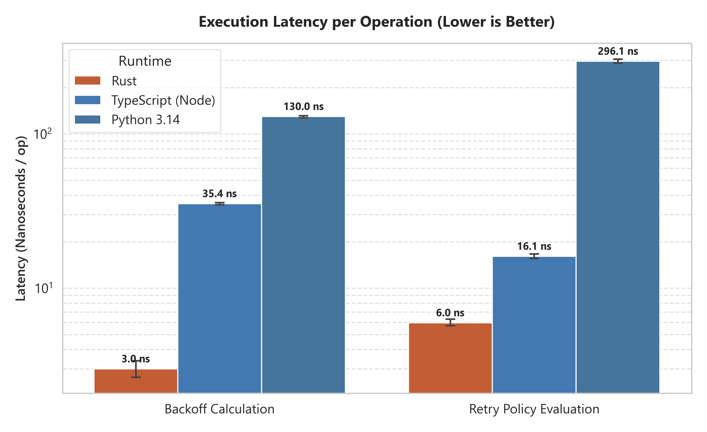
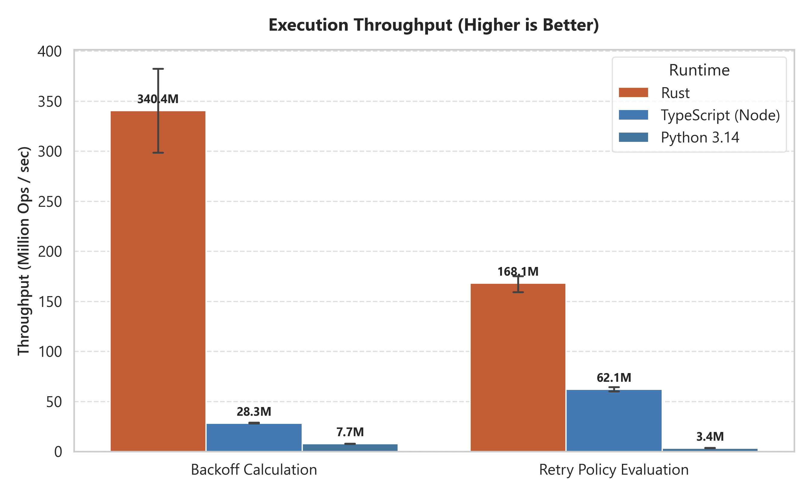

# Empirical Findings & Data Analysis

This document records observations and interpretations drawn directly from measured benchmark experiments.

> **Research Integrity Standard:** All claims and comparisons recorded here are grounded in data from `benchmarks/results/` and cite their specific experiment ID. No hypothetical or illustrative performance values are presented as findings.

---

## Experiment `exp-001`: Baseline Computation Cost

- **Date:** 2026-10-20
- **Hardware:** AMD Ryzen 7 7435HS (8 Cores, 16 Logical Processors) | Windows 11
- **Toolchains:** `rustc 1.93.1 (opt-level=3)` | `Node.js v22.20.0 (V8)` | `CPython 3.14.0`
- **Workload Volume:** 1,000,000 iterations per workload $\times$ 5 rounds per language (counterbalanced execution order).
- **Data Source:** [benchmarks/results/exp-001/summary.json](../benchmarks/results/exp-001/summary.json) & [raw.csv](../benchmarks/results/exp-001/raw.csv)

### Summary Table

| Workload | Language | Median Latency | Stdev | Throughput (ops/sec) | Relative Cost vs. Rust |
|---|---|:---:|:---:|:---:|:---:|
| **Backoff Calculation** | **Rust** | **2.81 ns/op** | $\pm 0.44$ ns | **356,036,601** | **1.00x (Baseline)** |
| *(Deterministic math)* | **TypeScript** | 35.19 ns/op | $\pm 0.66$ ns | 28,420,637 | 12.53x overhead |
| | **Python** | 130.79 ns/op | $\pm 2.33$ ns | 7,646,113 | 46.56x overhead |
|---|---|---|---|---|---|
| **Retry Policy Evaluation** | **Rust** | **5.76 ns/op** | $\pm 0.35$ ns | **173,701,581** | **1.00x (Baseline)** |
| *(Branching & parsing)* | **TypeScript** | 16.08 ns/op | $\pm 0.62$ ns | 62,201,820 | 2.79x overhead |
| | **Python** | 294.15 ns/op | $\pm 11.09$ ns | 3,399,683 | 51.09x overhead |

---

### Graphical Visualizations

  
  

---

### Key Empirical Observations

1. **Pure Arithmetic Efficiency (Backoff):**
   - Rust executes deterministic exponential backoff in **2.81 ns/op**, operating at over 350 million operations per second.
   - V8 (Node.js) JIT compiles the power calculation (`2 ** attempt`) and `Math.min` efficiently, completing in **35.19 ns/op** (approx. 28.4M ops/sec).
   - Python bytecode evaluation takes **130.79 ns/op** (approx. 7.6M ops/sec).

2. **Branching & State Evaluation (Retry Policy):**
   - In policy evaluation (handling status code arrays, attempt limit checks, and header string parsing), TypeScript performs remarkably well at **16.08 ns/op** (within 2.8x of native Rust). V8's inline caching optimizes array inclusion and dictionary creation heavily.
   - Rust executes the enum matching, `should_retry` comparison, and string parsing in **5.76 ns/op** (173.7M ops/sec).
   - CPython 3.14 takes **294.15 ns/op** (3.4M ops/sec), showing significant overhead from dynamic dictionary allocation and runtime dispatch.

---

### Critical Limitations & Non-Claims

> [!WARNING]
> **Pure computation $\neq$ End-to-end network speed:**
> While Rust is 12x–46x faster than Node.js and Python at calculating backoff in-process, this pure computation difference represents **less than 0.0001 ms**. 
> In a real web application with a 50ms HTTP network request, calculating backoff in 2.8ns vs. 35ns vs. 130ns has zero measurable impact on end-user latency.
> 
> Therefore, **the primary value of a Rust core at low scale is deterministic cross-language behavioral parity and safety, not microsecond latency savings.**
> Rust-backed performance gains will only become relevant when native binding overhead (FFI) is measured and high-concurrency request coalescing / deduplication is evaluated.
